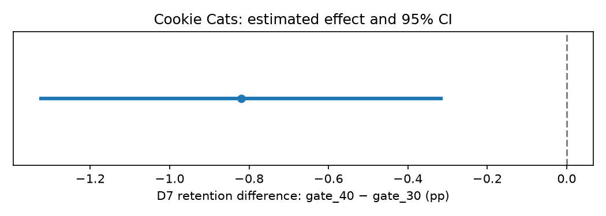

# Cookie Cats: Day-7 Retention A/B Reanalysis

**Python · pandas · statsmodels · matplotlib**

A compact educational reanalysis of a published Cookie Cats experiment. The question is whether moving the first gate from level 30 to level 40 changes the proportion of players returning on day 7.

This project analyzes an existing dataset; it does not claim to have designed or run the original experiment.

## Results

| Version | Players | Returned on day 7 | D7 retention |
|---|---:|---:|---:|
| gate_30 | 44,700 | 8,502 | 19.02% |
| gate_40 | 45,489 | 8,279 | 18.20% |

- **Estimated difference, gate_40 minus gate_30:** -0.82 percentage points.
- **95% Newcombe confidence interval:** [-1.33, -0.31] percentage points.
- **Two-sided two-proportion z-test:** z = -3.1644, p = 0.001554.

The interval is entirely below zero, consistent with the test rejecting equal retention rates at the 5% significance level. The evidence favors keeping the gate at level 30 **when day-7 retention is the decision metric**. The dataset does not contain revenue, so this is not a recommendation about profitability.



The point is the estimated difference, the horizontal line is its confidence interval, and the dashed vertical line denotes no difference.

## Scope and method

1. Check row count, missing values, unique player IDs, data types and group sizes.
2. Use **D7 retention as the single primary outcome**. Retention on day 1 and game-round counts are not additional hypothesis tests in this small project.
3. Include every recorded player in their assigned version; do not select players based on activity after assignment.
4. Compare unrounded group proportions using a two-sided z-test with alpha = 0.05.
5. Estimate the difference with a 95% Newcombe interval and report effects in percentage points.

The 90,189 rows have unique user IDs and no missing values. This verifies basic data structure, not the original randomization or logging process. The source describes random assignment; allocation probabilities, timestamps and the full experimental protocol are unavailable here. Complete follow-up and independent observations are assumptions of the analysis. A full experiment-health audit is outside this introductory project's scope.

## Reproduce

1. Download `cookie_cats.csv` from the [Kaggle dataset](https://www.kaggle.com/datasets/yufengsui/mobile-games-ab-testing), which credits the DataCamp project.
2. Place it in `data/raw/cookie_cats.csv`.
3. Install the dependencies in a Python environment:

   ```bash
   python -m pip install -r requirements.txt
   ```

4. Open [cookie_cats_ab_test.ipynb](cookie_cats_ab_test.ipynb) in Jupyter, VS Code or Colab. Run all cells from the project root. In Colab, upload the data into the same `data/raw/` layout.

The notebook creates the figure, a group summary and machine-readable results in `outputs/`. The validation record reports the environment used for the clean-kernel execution.

## Files

- [Notebook](cookie_cats_ab_test.ipynb): explanations, executable analysis and saved outputs.
- [Group summary](outputs/summary.csv): group counts and retention rates.
- [Results](outputs/results.json): unrounded test statistics, effect and interval.
- [Validation](outputs/validation.json): execution and consistency checks.
- [Data notes](data/README.md): source and column definitions.

The raw CSV is not redistributed. This is a learning case using a well-known dataset, not a novel discovery or a reproduction of another author's notebook code.
